<!--  meeting this Thursday November 5 at 12pm EST -->

# Academic Research

{.slide-figure .medium fig-alt="Allegheny College"}

::: {.beamer-block .blue}
**Senior Academic Research Projects**

- **Third year:** complete a seminar course to provide research fundamentals.
- **Fourth year:** complete an original academic research project in the major.
- **Faculty** members mentor senior projects.
:::

## Success in Academic Research

**Generally said, ...**

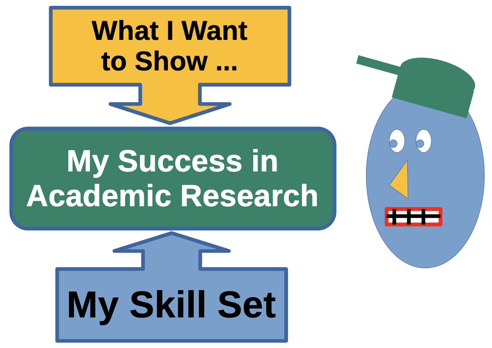{.slide-figure .wide fig-alt="A research-success graphic"}

::: {.beamer-block .blue}
**How do I know when I am doing things right?**

Success results when the **research question** meets one's **skill**.
:::

## Slow Starts in Beginner Projects

Starting a research project can be overwhelming for novice researchers, often because it is difficult to narrow down a clear research question amid a **flood of information**. This can lead to frustration and delays in getting started.

::: {.beamer-block .purple}
**Challenges in Research**

- Beginning the project itself
- Formulating clear hypotheses (Knox *et al.*)
- Searching for credible sources (Alisic *et al.*)
- Overcoming imposter syndrome (Ossovski *et al.*)
:::

## Challenges in Beginning Research

{.slide-figure .wide fig-alt="Students learning in a research lab"}

::: {.beamer-block .orange}
**The cause of these problems?**

- Difficulty discerning relevant literature for an idea
- Literature reviews are insufficient:
  - Difficulty identifying a *feasible* research topic
  - Difficulty developing a research question
  - Lack of enthusiasm and inspiration
:::

## My Experience: One Cause of Troubles

**After an area of interest has been established**

::: {.rings}
```{=html}
<div class="rings-figure" aria-label="Concentric rings represent the foundational role of literature review">
  <span class="ring ring-outer"></span>
  <span class="ring ring-four"></span>
  <span class="ring ring-three"></span>
  <span class="ring ring-two"></span>
  <span class="ring ring-core"></span>
</div>
<div class="rings-labels">
  <span>Literature review</span>
  <span>Method</span>
  <span>Finding data</span>
  <span>Enthusiasm</span>
  <span>Confidence</span>
  <strong>Hardships result in absence of good project literature</strong>
</div>
```
:::

::: notes
The original Beamer slide uses concentric rings and arrows to relate these research needs to project literature. This CSS diagram preserves the information and layered visual.
:::

## Which Books Contain the Best Ideas?

### Finding an idea across lots of books is hard!

{.slide-figure .wide fig-alt="Books representing the volume of literature to search"}

::: {.beamer-block .orange}
There are often too many results to be helpful in the initial steps of creating a literature review.
:::

## Which Article Contains the Best Ideas?

### Finding an idea across lots of articles is also hard!

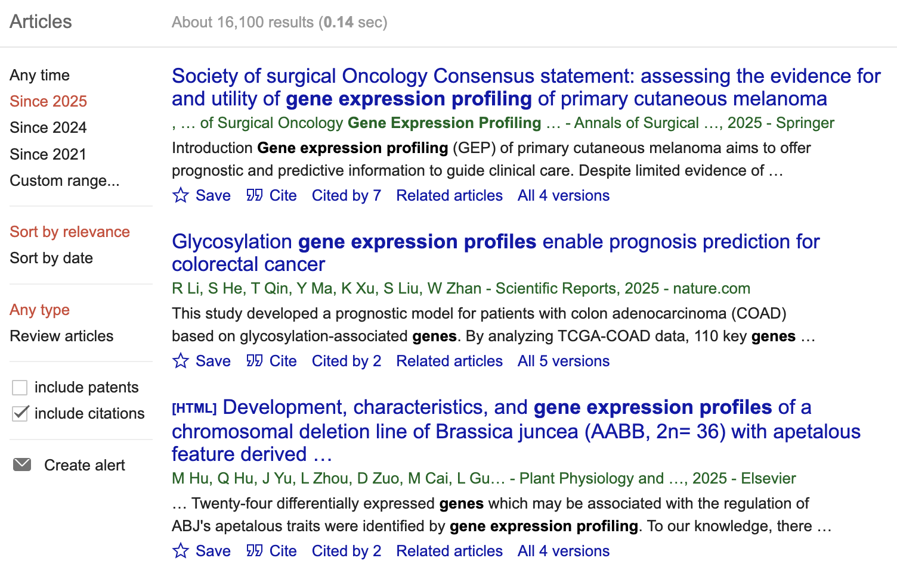{.slide-figure .wide fig-alt="Google Scholar results for a broad search"}

::: {.beamer-block .orange}
Note: about 16,000 results just for the year 2025.
:::

## We May Ask

{.slide-figure .poster fig-alt="The question of how to address informational overload"}

# Visual Learning

::: {.beamer-block .green}
**Benefits**

- **Visual learning:** instruction based on visual cues and graphics, with less dependence on reading text.
- Visual learning is often more productive for young people than non-visual learning.
:::

::: {.beamer-block .orange}
**Published Work**

- Visuals enhance cognitive engagement (Tong, Yang, and Chen, 2024).
- Diagrams, charts, and videos improve memory retention (Ahmad and Abd Halim, 2024).
- Interactive tools boost motivation and focus.
:::

## BeagleTA

*Low-End, Local, Text Analysis and Visualization for Literature Reviews*


<center>
{width="20%"}
</center>

<center>
<a href="https://github.com/developmentAC/BeagleTA">https://github.com/developmentAC/BeagleTA</a> 
</center>


::: {.beamer-block .green}

- A literature-parsing system to help locate articles on specific topics.
- Visual and interactive output helps find relevant articles according to keywords.
:::

## Local Corpus

**Non-commercial article data**

{.slide-figure .wide fig-alt="PubMed"}

::: {.beamer-block .green}

- PubMed contains millions of articles in STEM science and other fields.
- [PubMed Central Open Access non-commercial bulk data](https://ftp.ncbi.nlm.nih.gov/pub/pmc/oa_bulk/oa_noncomm/)
:::

## Bundled Tools

**Because some analyses are involved!**

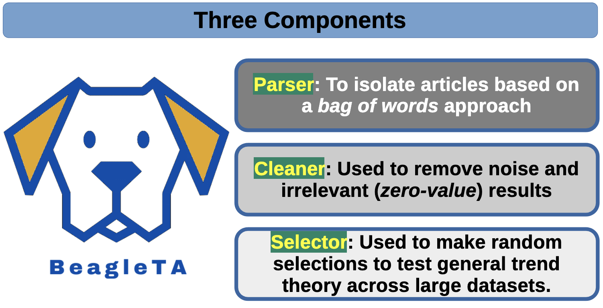{.slide-figure .wide fig-alt="BeagleTA's Parser, Cleaner, and Selector components"}

::: {.beamer-block .orange}

- Supports different types of article analyses.
- Corpus quality may be studied for its content.
:::

## BeagleTA: Workflow

<center>
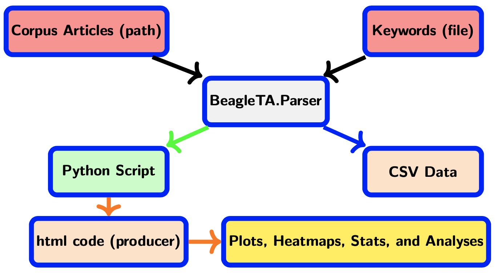{width="80%"}
</center>

## Tech Stack for BeagleTA
<!-- 
::: {.beamer-block .green}
- **Frontend:** Rust, Python
- **AI/ML:** Python, scikit-learn, Networkx, Others
::: -->


<center>

{width="25%"}
{width="10%"}
{width="15%"}
{width="10%"}
{width="25%"}

</center>

::: {.columns}

::: {.column}
::: {.beamer-block .green}
- **Frontend:** Rust, Python
:::

:::

::: {.column}
::: {.beamer-block .blue}
- **AI/ML:** Python, scikit-learn, Networkx, Others
:::

:::

:::


## The Screenshot of Running Parser

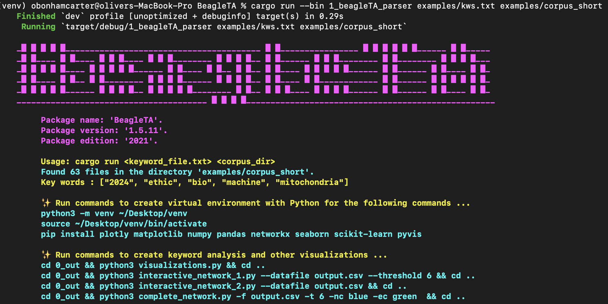{.slide-figure .wide fig-alt="BeagleTA parser output showing matched files, keywords, and suggested commands"}

::: {.beamer-block .orange}
**Custom Generated Python Script**

After parsing articles for keywords, suggested commands are presented to further the analysis.
:::

# We May Ask

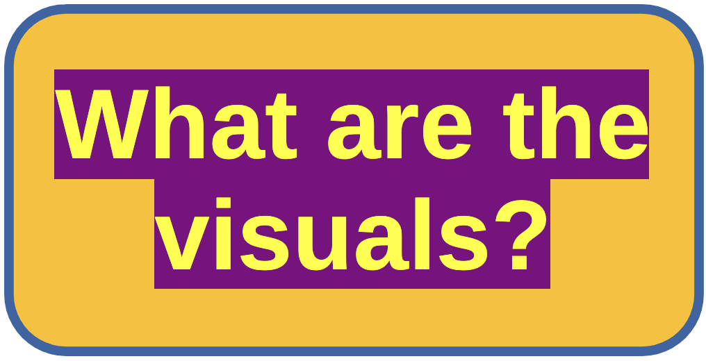{.slide-figure .poster fig-alt="Examples of questions addressed by BeagleTA visualizations"}

## Articles Found From Keywords (BeagleTA)

<center>
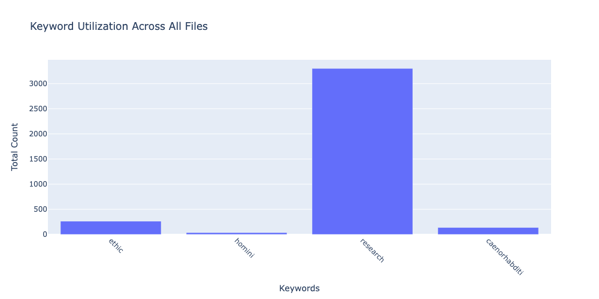{width=60%}
</center>

<!-- {.slide-figure .wide fig-alt="Keyword utilization across all files"} -->

::: {.beamer-block .orange}

- Magnitudes represent the number of articles returned by the keywords.
- Some keywords can be too general; others may not be specific enough.
:::

## K-Means Clustering of Cosine Similarities (BeagleTA)

<!-- 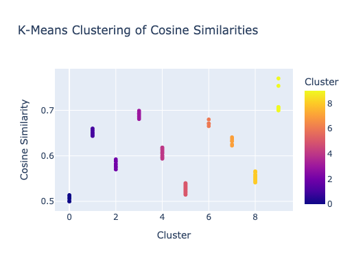{.slide-figure .medium fig-alt="K-means clustering of cosine similarities"} -->

<center>
{width=50%}
</center>

::: {.beamer-block .orange}
K-means clustering of cosine similarity shows diversity in the results.
:::

## Heatmaps: Keyword Occurrences in Articles (BeagleTA)

<center>
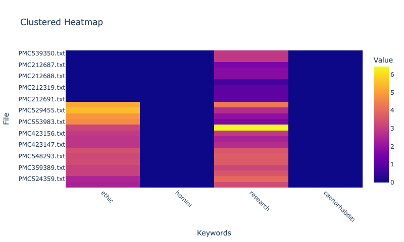{width=50%}
</center>

<!-- {.slide-figure .wide fig-alt="Heatmap of keyword occurrences in selected articles"} -->

::: {.beamer-block .orange}

- Heatmaps show keywords found across the articles.
- Articles containing more of the selected keywords may be better fits for a literature review.
:::

## Interactive Networks: Relationship Visualization (BeagleTA)

<center>

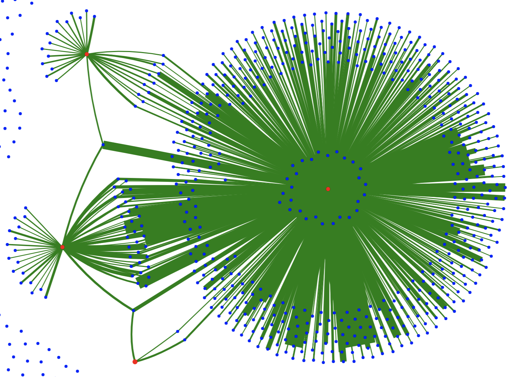{width="40%"}

</center>

<!-- <center>
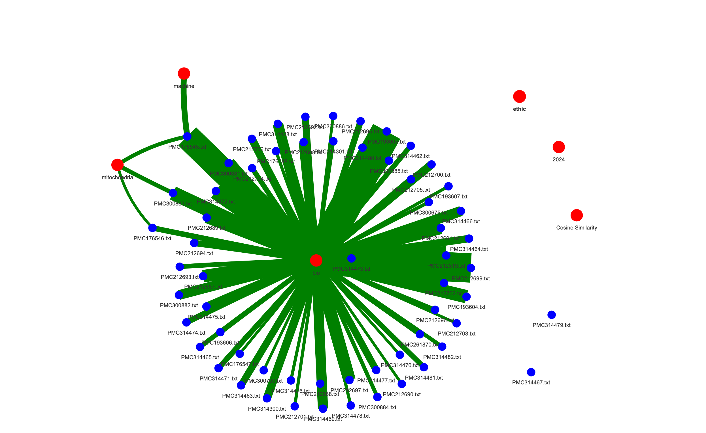{width="50%"}
</center> -->

<!-- {.slide-figure .network fig-alt="Network view with article and keyword nodes"} -->

::: {.beamer-block .orange}

- Blue nodes are articles (PMIDs); red nodes are keywords.
- Edges represent connections through common keywords.
:::

# CuraLit

*High-End, Local Literature Curation With AI Support*

<center>
{width="20%"}
</center>

<center>
CuraLit GitHub Project: <a href="https://github.com/developmentAC/curalit">https://github.com/developmentAC/curalit</a> 
</center>

::: {.beamer-block .green}
- CuraLit is a simple, browser-based tool that uses AI to help students write literature reviews.
:::


## CuraLit: Workflow

<center>
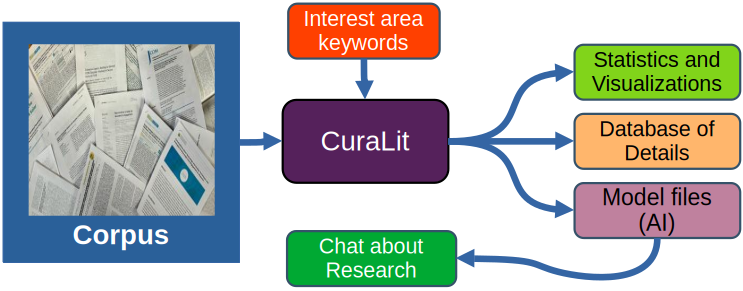{width="100%"}
</center>

## Tech Stack for CuraLit

<center>

{width="15%"}
{width="04%"}
{width="10%"}
{width="04%"}
{width="20%"}
</center>

<center>
{width="04%"}
{width="15%"}
{width="04%"}
{width="15%"}
{width="04%"}
{width="10%"}
</center>

::: {.columns}

::: {.column}
::: {.beamer-block .green}
- **Frontend:** Rust, Python, HTML, Flask
- **Backend:** Docker, Ollama
:::

:::

::: {.column}
::: {.beamer-block .blue}
- **Database:** Sqlite3
- **AI/ML:** Python, scikit-learn, NetworkX
:::

:::

:::

<!-- ## Improved Visuals: Interactive Networks


<center>
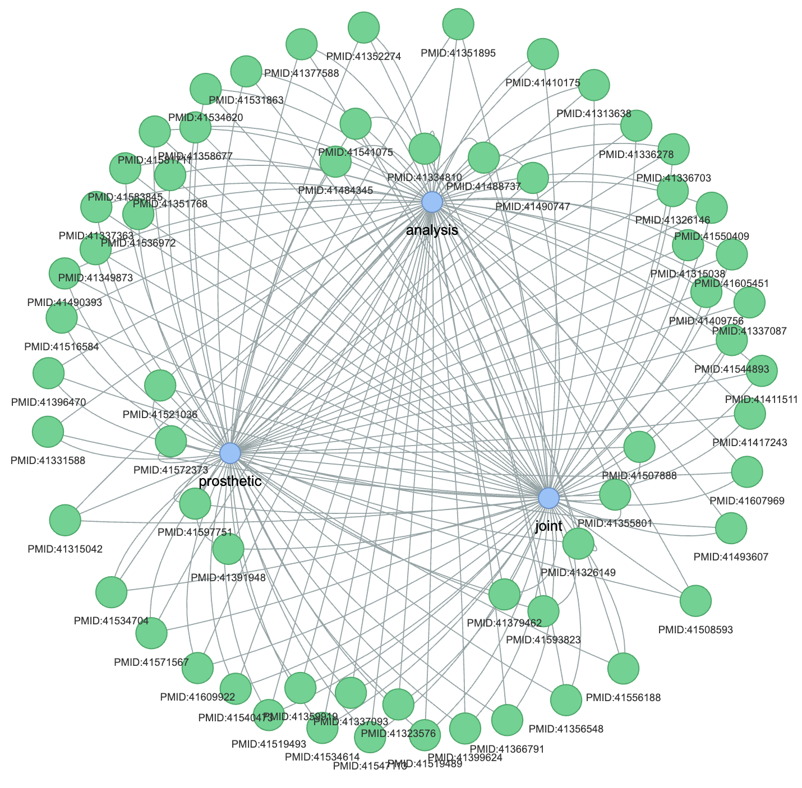{width="45%"}
</center>

## Improved Visuals: Interactive Journal Selection

<center>
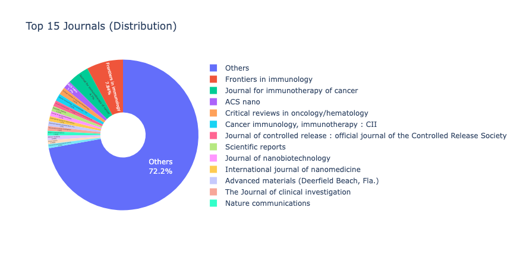{width="85%"}
</center>
 -->

## Improved Visuals: Interactive Network

::: {.beamer-block .blue}

<iframe src="scripts/results__keyword_network.html" style="width:100%; height:600px; border:none;"></iframe>
:::

<center>
{width="45%"}
</center>

(Similar graphic)

## Improved Visuals: Interactive Journal Groups


::: {.beamer-block .blue}

<iframe src="scripts/results__journals.html" style="width:100%; height:600px; border:none;"></iframe>
:::


<center>
{width="85%"}
</center>

(Similar graphic)

## Browser-Based For Simplicity


::: {.beamer-block .yellow}
*"I like using CuraLit because it helps in project development but command line work is not intuitive for me"*

-Student Tester
:::

::: {.beamer-block .orange}
*"Could we use a clickable interface instead using the CLI controls?"*

-Student Tester
:::

::: {.beamer-block .purple}
- CuraLit can be engaged by command line function and by browser-based controls which are designed to be more user-friendly and accessible
- CLI commands are given when using the browser-based interface
:::

## Keyword Search and Article Selection

<center>
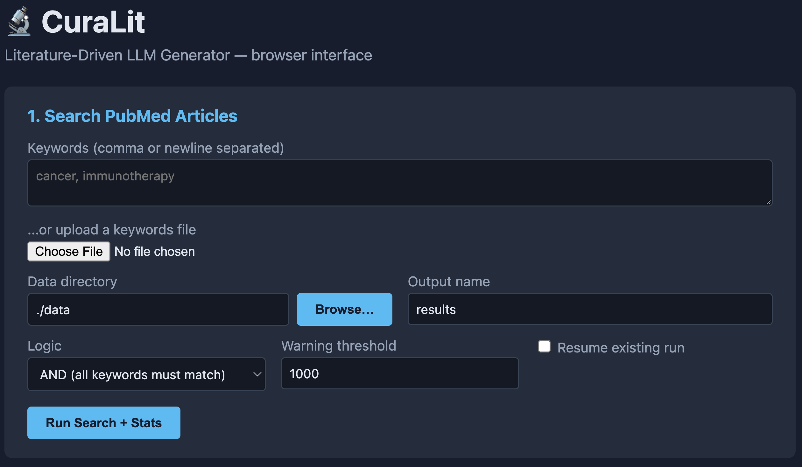{width="90%"}
</center>

::: {.beamer-block .orange}
- Students search for keywords of interest areas. Articles are selected based on these keywords.
- The interface is designed to be easy to use, even for students with no programming experience.
:::
## Analysis of KWs, MeSH Frequencies, Authors, Journals and Etc. 

<center>
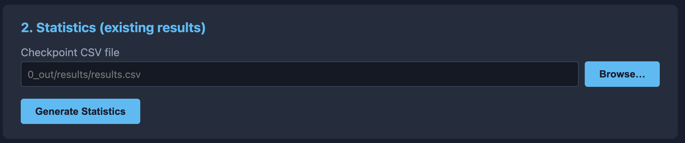{width="90%"}
</center>

::: {.beamer-block .orange}
- Generated statistics and visualizations help students understand the literature and select articles for their review.
:::
## Create Ollama Models for Literature Review

<center>
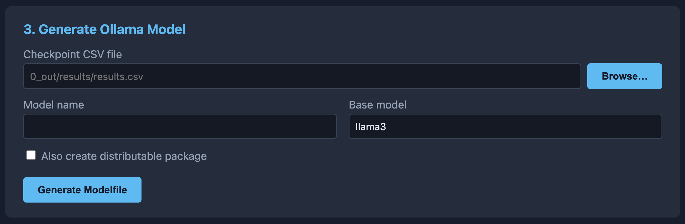{width="90%"}
</center>

::: {.beamer-block .orange}
- Ollama is used to create local AI models for literature review and handles all AI operations with the created models.
:::

## Create Database to Ensure Factuality

<center>
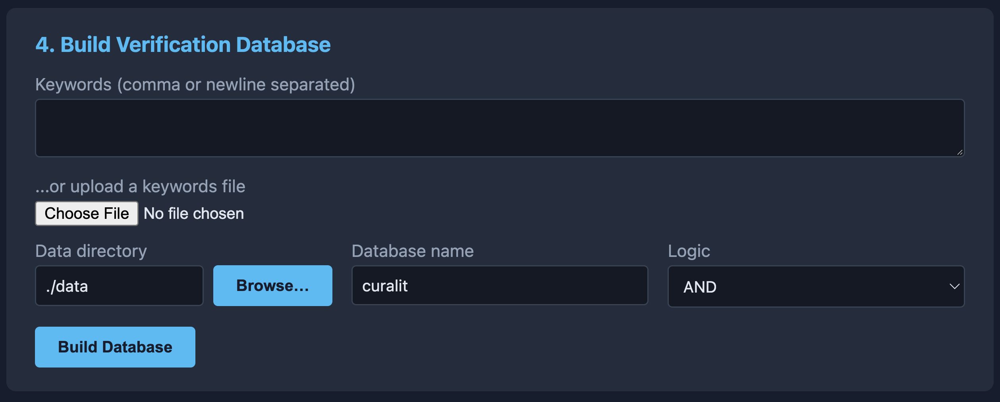{width="85%"}
</center>

::: {.beamer-block .orange}
- Collection of article citation details and abstracts in a local SQLite database ensures that the AI model can answer questions with factual information.
:::

## Create RAG  Index for Literature Review

<center>
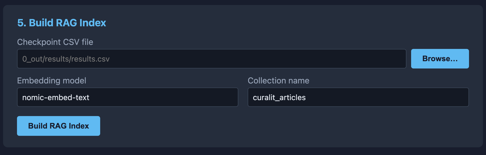{width="80%"}
</center>

::: {.beamer-block .orange}
- RAG (Retrieval-Augmented Generation) embeds articles (via Ollama's `nomic-embed-text` model) into a local Qdrant (Docker) vector storage structure.
- This allows for the generation of responses based on the exact text of matching articles.
:::

## Ask a Question About the Literature

<center>
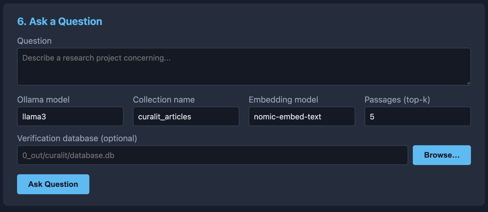{width="75%"}
</center>
::: {.beamer-block .orange}
- Students can ask questions about the literature and receive answers and article summaries based on the articles in the database.
:::


## Concluding Thoughts

::: {.beamer-block .green}

- BeagleTA and CuraLit offer various tools and features that provide to assist new investigators in their research development.
- Each tool requires different amount of computation power and so if a machine has limited resources, BeagleTA may be a better choice for the initial literature review.
- Supporting students in their research development is a key factor in helping them succeed as students and in their careers.
:::

## Future Works

{.slide-figure .medium fig-alt="Allegheny College"}

::: {.beamer-block .orange}

- Further development of CuraLit to use fewer resources and to be more user-friendly.
- Working on plans to put these tools in the hands of young researchers across STEM fields.
- It is hoped that resources such as these will help attract more students into scientific research.
:::

## Cited Works

::: {.beamer-block .green}
- **Knox, C. J.** *et al.* 2024. *Mentoring across difference and
distance: building effective virtual research opportunities
for underrepresented minority undergraduate students in
biological sciences*. Mbio 15(1):e01452–23.
- **Alisic, A.,** *et al.* 2024. *How long can I wait
and how much frustration can I stand? Volitional traits and
students’ phd-intention and pursuit.* International Journal
for Educational and Vocational Guidance 24(1):99–123.
- **Ossovski, E.,** *et al.* 2024. *Frustration
tolerance among computer-science-related novice university
students.* European Journal of Engineering Education 1–18.
Park, H.; Ahn, B.; and Kim, T. 2024. An exploration of
research trends on metaverse: topic modeling with latent
dirichlet allocation. Quality & Quantity 1–20.
:::


## Reach Out!

**Questions, Comments, or Whatever!**

{.slide-figure .medium fig-alt="Allegheny College campus"}

::: {.beamer-block .orange}
### Contact and References

- [obonhamcarter(a)allegheny.edu](mailto:obonhamcarter@allegheny.edu)
- [www.oliverbonhamcarter.com](https://www.oliverbonhamcarter.com/)
- BeagleTA GitHub Project: <a href="https://github.com/developmentAC/BeagleTA">https://github.com/developmentAC/BeagleTA</a> 
- CuraLit GitHub Project: <a href="https://github.com/developmentAC/curalit">https://github.com/developmentAC/curalit</a>
:::
